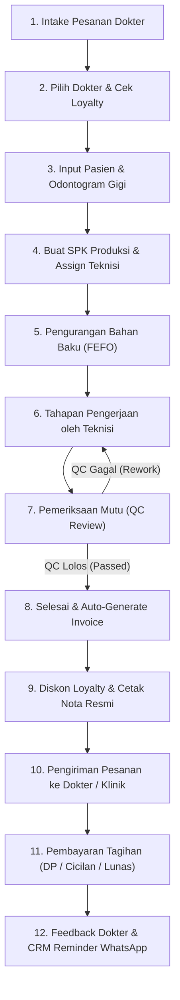

# DENTALLAB PRO — DOKUMENTASI PERUBAHAN FITUR & FLOW OPERASIONAL TERBARU
**Tanggal Rilis:** 2 November 2026  
**Versi Sistem:** v2.4.0 (Full Suite Dental Laboratory ERP & CRM)  
**Repositori Backend:** [BE_DL (Go/Fiber/GORM)](https://github.com/amanda-nurabsharina/BE_DL.git)  
**Repositori Frontend:** [FE_DL (React/Vite/TypeScript)](https://github.com/amanda-nurabsharina/FE_DL.git)  

---

## 1. RINGKASAN EKSEKUTIF (EXECUTIVE SUMMARY)

Hari ini telah dilakukan pembaruan berskala besar dan komprehensif pada ekosistem **DentalLab Pro**, meliputi penambahan fitur operasional berbasis kebutuhan laboratorium gigi modern, pemenuhan standar kepatuhan medis, kendali mutu (QC), manajemen SDM & teknisi, pencatatan keuangan akrual otomatis, dan audit keamanan.

Semua fitur baru telah terintegrasi secara **end-to-end** antara Backend (Go Fiber) dan Frontend (React Vite + Tailwind CSS), mendukung tampilan **Bilingual Penuh (🇮🇩 Bahasa Indonesia & 🇬🇧 English)**, serta mode **Terang & Gelap (Light / Dark Mode)**.

---

## 2. DETAIL PERUBAHAN FITUR HARI INI

### A. Odontogram Interaktif & Visualisasi Gigi Standar FDI (World Dental Federation)
* **Visual Gigi Interaktif:** Menggunakan sistem penomoran dua digit standar internasional FDI:
  * Kuadran 1: Gigi Rahang Atas Kanan (18 - 11)
  * Kuadran 2: Gigi Rahang Atas Kiri (21 - 28)
  * Kuadran 3: Gigi Rahang Bawah Kiri (31 - 38)
  * Kuadran 4: Gigi Rahang Bawah Kanan (41 - 48)
* **Aksi Cepat (Quick Select):**
  * Pilih Semua Gigi Rahang Atas (*Upper Jaw* / 16 elemen).
  * Pilih Semua Gigi Rahang Bawah (*Lower Jaw* / 16 elemen).
  * Tombol Reset / Hapus Pilihan Gigi.
* **Integrasi Data SPK & Invoice:** Elemen gigi yang dipilih pada Odontogram otomatis tersimpan dalam data SPK (`teeth_numbers`) dan tercantum di Nota Invoice Resmi serta form pengerjaan teknisi.

---

### B. Master CRM Dokter & Pasien + Sistem Diskon Loyalty Otomatis
* **Database Master Dokter & Klinik:**
  * Pencatatan nama dokter, nama klinik/RS, kontak WhatsApp aktif, email, dan alamat pengiriman.
  * Preferensi shade warna gigi favorit dokter (VITA A1, A2, A3, Bleach, dll).
  * Tipe gigi tiruan favorit dokter (Zirconia Crown, Valplast, Akrilik, dll).
  * Catatan khusus kebiasaan dokter (oklusi ringan, kontak proksimal rapat, margin servikal halus).
* **Sistem Loyalty Tier & Diskon Otomatis:**
  * Kategori member: **REGULAR (Diskon 0%)**, **SILVER (Diskon 5%)**, **GOLD (Diskon 10%)**, dan **VIP Partner (Diskon 15%)**.
  * Saat input SPK baru untuk dokter tersebut, diskon loyalty otomatis memotong harga total pesanan tanpa perlu kalkulasi manual.
* **Database Master Pasien Laboratorium:**
  * Data identitas pasien (Nama, Jenis Kelamin, Usia, No. Telepon/Wali).
  * Terhubung langsung dengan riwayat dokter pengirim (*referral doctor*).
  * Riwayat elemen gigi dan shade gigi dasar pasien.
  * Catatan klinis & riwayat alergi bahan (misal: alergi nikel logam disarankan menggunakan Valplast/Zirconia, riwayat bruxism).
* **Feedback & Evaluasi Kepuasan Dokter:**
  * Modul pencatatan rating bintang (1 - 5 bintang) dan testimoni dokter terhadap hasil pesanan gigi tiruan.
  * Terhubung ke kartu KPI performa teknisi.
* **Reminder Follow-Up Order Berkala:**
  * Sistem mendeteksi otomatis dokter yang sudah lebih dari 14 hari belum memesan SPK baru.
  * Tombol 1-klik untuk mengirim pesan sapaan dan follow-up via WhatsApp Web/API.

---

### C. Manajemen SDM & Penugasan Teknisi (HR & Tasks)
* **Profil Teknisi & Staf Laboratorium:**
  * Profil keahlian teknis (*skills matrix*): Akrilik, Valplast Fleksibel, Keramik/Porcelain, Zirconia CAD/CAM, Pengecoran Logam (Casting), Finishing & Polishing.
  * Jadwal kerja shift (Senin - Sabtu 08:00 - 17:00).
  * Status aktif, cuti, atau non-aktif.
* **Penugasan Teknisi (Work Order Assignment):**
  * Admin / SPV dapat menugaskan teknisi penanggung jawab (*Technician PIC*) saat pembuatan SPK maupun saat update tahapan produksi.
* **KPI & Indikator Kinerja Produksi:**
  * Jumlah order aktif yang sedang ditangani teknisi.
  * Jumlah pesanan selesai tepat waktu (*On-Time Completion Rate*).
  * Jumlah tahapan produksi yang diselesaikan.
* **Absensi & Lembur Staf:**
  * Pencatatan jam masuk (*clock-in*), jam pulang (*clock-out*), dan durasi lembur (*overtime hours*).
  * Terintegrasi dengan pelaporan beban biaya tenaga kerja di modul keuangan.

---

### D. Halaman Profil Saya (My Profile) & Avatar Upload
* **Tampilan Khusus Personal Pengguna Login:**
  * Menampilkan informasi akun: Kode Karyawan, Nama Lengkap, Username, Role Akun, No. WhatsApp, Email, Spesialisasi, Alamat, Bio, dan Tanggal Bergabung.
  * Fitur unggah foto profil (Avatar Upload) tersimpan ke server.
  * Kemampuan mengedit data kontak pribadi, jadwal kerja, dan bio pribadi.
* **Daftar Tugas SPK Saya (My Assigned Tasks):**
  * Teknisi dapat melihat daftar pekerjaan SPK aktif yang khusus ditugaskan kepadanya beserta tenggat waktu pengerjaan (*due date*).

---

### E. Penjualan & Keuangan (Invoicing, HPP & Cashflow)
* **Integrasi Otomatis dengan Produksi:**
  * Begitu status SPK disetujui QC dan diselesaikan (`COMPLETED`), invoice resmi diterbitkan secara otomatis oleh sistem.
* **Sistem Pembayaran Bertahap:**
  * Mendukung pencatatan Uang Muka / DP (*Deposit*), Cicilan (*Partial*), dan Pelunasan (*Final*).
  * Pilihan metode bayar: Transfer Bank, Tunai (Cash), dan QRIS.
* **Dokumen Preview & Cetak Nota Resmi Invoice:**
  * Format cetak siap kertas A4 / PDF.
  * Menampilkan rincian identitas dokter, pasien, shade, dan elemen gigi.
  * Memuat lampiran foto bukti hasil order gigi tiruan yang telah melewati sertifikasi lolos QC.
* **Pencatatan Biaya Produksi & Operasional (Expense Tracking):**
  * Kategori pengeluaran: Bahan Baku Produksi (Direct Material), Gaji & Lembur Teknisi (Direct Labor), Listrik/Air/Gas (Overhead), Servis Alat & Burnout Furnace, Logistik & Kurir, dan ATK Kantor.
  * Dapat dikaitkan langsung ke nomor SPK spesifik untuk menghitung HPP per pesanan.
* **Laporan Penjualan & Profitabilitas:**
  * Visualisasi grafik omset mingguan dan bulanan.
  * Perhitungan Total Omset, Laba Kotor, Laba Bersih Operasional, dan Saldo Piutang Dokter.

---

### F. Stok & Bahan (Inventori), Lot Batch & FEFO Otomatis
* **Manajemen Bahan Baku & Alat Laboratorium:**
  * Pencatatan stok real-time, satuan unit, supplier utama, dan harga beli terakhir.
  * Peringatan otomatis jika stok berada di bawah batas minimum (*safety stock*).
* **Metode First-Expired-First-Out (FEFO):**
  * Pencatatan nomor Batch / Lot dan tanggal kadaluarsa (*Expired Date*) saat stok masuk.
  * Saat pencatatan pemakaian bahan (stok keluar), sistem memprioritaskan batch yang paling mendekati tanggal kadaluarsa secara otomatis.
* **Sistem Approval Pembelian Bahan (Owner ACC):**
  * Teknisi mengajukan *Purchase Request* (PR).
  * Stok tidak dapat masuk gudang sebelum disetujui (ACC) oleh akun Owner / Pemilik Lab.

---

### G. Akses Online Web / Mobile & Update Cepat
* **Mode Update Cepat (Mobile / Web Quick Action):**
  * Modal responsif layar sentuh untuk teknisi atau kurir di lapangan.
  * Tombol 1-tap untuk memperbarui status pesanan: `Order Masuk` → `Dalam Proses` → `Siap QC` → `Selesai (+Auto Invoice)` → `Dikirim ke Dokter`.
* **Sistem Peringatan Otomatis (Auto Alerts):**
  * Deteksi dini pesanan yang terancam terlambat (*Late Production Warning*).
  * Notifikasi stok bahan menipis.
  * Notifikasi invoice yang telah melewati batas tempo pembayaran (*Overdue Invoices*).

---

### H. Modul Keamanan, Audit Log & Backup Data
* **Log Aktivitas Pengguna (Audit Trail):**
  * Mencatat detail: Siapa yang melakukan aksi (User ID, Nama, Role), Tipe Aksi (`CREATE`, `UPDATE`, `DELETE`, `LOGIN`, `BACKUP`), Modul yang diubah, Waktu kejadian, dan IP Address pengguna.
  * Filter pencarian berdasarkan modul dan user untuk transparansi operasional.
* **Pencadangan Data (Database Backup & Restore):**
  * Tombol 1-klik untuk membuat file snapshot cadangan database SQLite (`.db`).
  * Informasi ukuran database, waktu backup terakhir, dan tautan unduh arsip data aman.

---

### I. Fitur Multi-Bahasa Penuh (🇮🇩 ID ↔ 🇬🇧 EN)
* **Bilingual Switcher:**
  * Tombol bendera di navigasi atas (`🇮🇩 ID` dan `🇬🇧 EN`).
  * Tersimpan di *Local Storage* per perangkat.
  * Menerjemahkan 100% komponen: Dashboard, Tabel SPK, Odontogram, Form Input, Stok Bahan, Nota Invoice Cetak, CRM Dokter & Pasien, Manajemen SDM, Profil, Log Audit, hingga seluruh Modal interaktif.

---

## 3. FLOW OPERASIONAL TERBARU (END-TO-END WORKFLOW)

Alur kerja laboratorium gigi kini terstandardisasi dari awal penerimaan order dokter hingga pelunasan dan follow-up:



### Penjelasan Tahapan Alur Kerja:
1. **Intake Pesanan Dokter:** Resepsionis / Admin menerima formulir order fisik atau pesan digital dari dokter/klinik rekanan.
2. **Pilih Dokter & Diskon Loyalty:** Sistem otomatis mengambil data preferensi dokter (shade & tipe gigi favorit) dan menerapkan tier diskon otomatis (Regular 0%, Silver 5%, Gold 10%, VIP 15%).
3. **Input Pasien & Odontogram:** Memilih atau menambahkan master pasien, mencatat riwayat alergi, dan memilih nomor elemen gigi pada Odontogram FDI kuadran 1–4.
4. **Buat SPK & Penugasan Teknisi:** SPK diterbitkan dengan nomor unik (contoh: `SPK-202611-0001`) dan langsung ditugaskan ke Teknisi Penanggung Jawab (*Technician PIC*).
5. **Pemakaian Bahan (FEFO):** Teknisi mengambil bahan di gudang, sistem secara otomatis mengurangi stok dari nomor batch yang memiliki masa kadaluarsa paling dekat.
6. **Tahapan Pengerjaan Teknisi:** Teknisi memperbarui tahapan kerja via Web atau Mobile View (Model Kerja → Wax-up → Casting → Porcelain → Finishing).
7. **Pemeriksaan Mutu (QC):** Supervisor QC memeriksa checklist 5 parameter (Oklusi, Marginal Fit, Kontak Proksimal, Kesesuaian Shade, dan Polishing). Bila ada cacat, order dikembalikan ke tahapan rework. Bila lolos, foto hasil akhir diunggah ke sistem.
8. **Auto-Generate Invoice:** Status pesanan diubah ke `COMPLETED`, sistem otomatis menerbitkan faktur tagihan dengan nomor invoice resmi.
9. **Cetak Nota Resmi:** Admin dapat mencetak nota pembayaran resmi lengkap dengan rincian biaya, elemen gigi, dan lampiran foto hasil produksi lolos QC.
10. **Pengiriman:** Kurir mengantarkan pesanan ke klinik dengan tanda terima.
11. **Pembayaran Tagihan:** Kasir mencatat pembayaran (Bank Transfer, Tunai, atau QRIS), sistem otomatis memperbarui status tagihan menjadi *PAID* atau *PARTIALLY_PAID*.
12. **Feedback & CRM Reminder:** Dokter memberikan rating kepuasan (1–5 bintang). Jika dokter tidak memesan dalam 14 hari, sistem memunculkan reminder untuk follow-up via WhatsApp 1-klik.

---

## 4. DAFTAR PERUBAHAN FILE TEKNIS

| Komponen | File | Deskripsi Perubahan |
| :--- | :--- | :--- |
| **Frontend** | `FE_DL/src/App.tsx` | Implementasi 8 modul utama, integrasi Odontogram, CRM, HR, Profil Saya, sistem bilingual penuh `tr(...)`, penanganan modal lengkap. |
| **Frontend** | `FE_DL/src/api.ts` | Interface TypeScript untuk User (`updated_at`, `avatar_url`), ProductionOrder, Invoice, ActivityLog, HR Attendance, and Loyalty CRM. |
| **Frontend** | `FE_DL/src/utils/i18n.ts` | Kamus bilingual lengkap ID ↔ EN untuk brand, navigasi, tabel, form, modal, dan pesan sistem. |
| **Frontend** | `FE_DL/src/components/Odontogram.tsx` | Komponen visual odontogram 32 gigi FDI dengan selector rahang atas dan bawah. |
| **Frontend** | `FE_DL/src/utils/whatsapp.ts` | Generator template pesan WhatsApp otomatis untuk notifikasi SPK dan CRM follow-up dokter. |
| **Backend** | `BE_DL/models/models.go` | Penambahan struct database: Customer (Loyalty Tier & Preferences), Patient, StaffAttendance, ActivityLog, Expense, dan Invoice Payment. |
| **Backend** | `BE_DL/controllers/` | Endpoint controller REST API untuk CRM, HR, Keuangan, Backup Database, dan Upload Avatar/Attachment. |
| **Backend** | `BE_DL/main.go` | Registrasi routing RESTful Fiber dan migrasi skema database GORM SQLite. |

---

## 5. CARA MENJALANKAN & MENGUJI SISTEM

1. **Jalankan Backend (Port 8080):**
   ```powershell
   cd "c:\Jody\Product\Dental LAB\BE_DL"
   go run .
   ```
2. **Jalankan Frontend (Port 3000):**
   ```powershell
   cd "c:\Jody\Product\Dental LAB\FE_DL"
   npm run dev
   ```
3. **Buka di Browser:**
   Akses `http://localhost:3000/`
4. **Akun Login Siap Pakai:**
   * **Super Admin:** `superadmin` / `admin12345` (Akses Penuh Seluruh Menu)
   * **Owner (Pemilik):** `owner` / `admin12345` (Akses Dashboard, Approval PR, Keuangan, Laporan)
   * **Admin Lab:** `admin` / `admin12345` (Akses Intake SPK, Master Dokter/Pasien, Inventori)
   * **Teknisi Gigi:** `teknisi1` / `admin12345` (Akses Papan Produksi, Tugas Saya, Absensi)
   * **Kasir / Finance:** `kasir` / `admin12345` (Akses Invoice, Pembayaran, Pengeluaran)

---
*Dokumen ini dibuat otomatis sebagai rangkuman resmi seluruh pengembangan fitur DentalLab Pro per 2 November 2026.*
