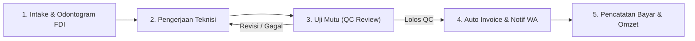
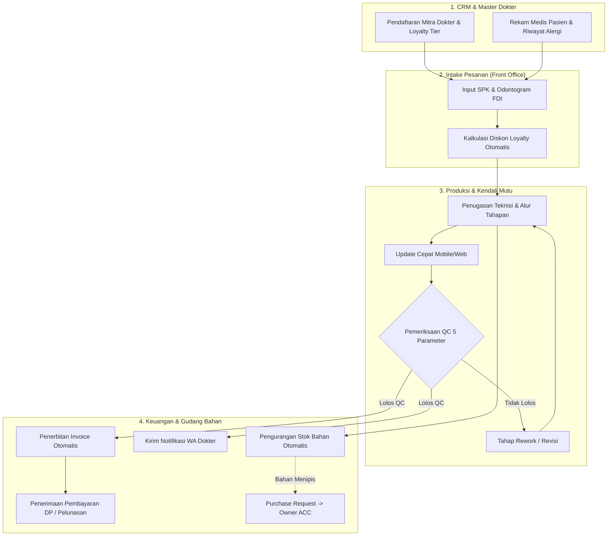

# PANDUAN PENGGUNAAN APLIKASI & MANUAL USER LENGKAP
## DENTALLAB PRO — SISTEM ERP & MANAJEMEN LABORATORIUM GIGI PRESISI

**Versi Panduan:** v2.5.0 (Multi-Tenant & Full Suite Edition)  
**Dokumen:** Manual Penggunaan & Alur Operasional End-to-End  
**Target Pengguna:** Super Admin, Pemilik Lab (Owner), Kepala Operasional / Admin, Teknisi Gigi, Kasir / Staf Keuangan

---

## DAFTAR ISI
1. [Ringkasan Peran & Hak Akses Pengguna](#1-ringkasan-peran--hak-akses-pengguna)
2. [Panduan Super Admin: Arsitektur Multi-Tenant & Cabang](#2-panduan-super-admin-arsitektur-multi-tenant--cabang)
3. [Alur Operasional Lengkap (End-to-End Workflow)](#3-alur-operasional-lengkap-end-to-end-workflow)
   - [Langkah 1: Manajemen Master Dokter & Pasien (CRM)](#langkah-1-manajemen-master-dokter--pasien-crm)
   - [Langkah 2: Intake & Input SPK Baru (Odontogram Interaktif FDI)](#langkah-2-intake--input-spk-baru-odontogram-interaktif-fdi)
   - [Langkah 3: Pengerjaan Produksi & Tracking Tahapan Teknisi](#langkah-3-pengerjaan-produksi--tracking-tahapan-teknisi)
   - [Langkah 4: Quality Control (QC Review) & Komunikasi WhatsApp](#langkah-4-quality-control-qc-review--komunikasi-whatsapp)
   - [Langkah 5: Penerbitan Invoice Otomatis & Keuangan](#langkah-5-penerbitan-invoice-otomatis--keuangan)
   - [Langkah 6: Manajemen Stok Bahan & Approval Pengadaan (Owner ACC)](#langkah-6-manajemen-stok-bahan--approval-pengadaan-owner-acc)
   - [Langkah 7: Manajemen SDM, Absensi & Lembur Teknisi](#langkah-7-manajemen-sdm-absensi--lembur-teknisi)
   - [Langkah 8: Audit Keamanan & Pencadangan Data (Backup & Restore)](#langkah-8-audit-keamanan--pencadangan-data-backup--restore)
4. [Diagram Alur Operasional (Mermaid Diagram)](#4-diagram-alur-operasional)
5. [Tanya Jawab & Penyelesaian Masalah (FAQ)](#5-tanya-jawab--penyelesaian-masalah-faq)

---

## 1. RINGKASAN PERAN & HAK AKSES PENGGUNA

DentalLab Pro menggunakan sistem keamanan **Role-Based Access Control (RBAC)** yang membatasi hak akses menu sesuai tugas kerja:

| Role Pengguna | Tanggung Jawab Utama | Akses Menu Default | Akun Demo Default |
| :--- | :--- | :--- | :--- |
| **SUPER_ADMIN** | Pengelola infrastruktur pusat, setup multi-tenant, pembuatan role global, konfigurasi sistem | Seluruh Menu + Setup Multi-Tenant | `superadmin` / `admin12345` |
| **OWNER** | Pemilik lab, monitoring performa bisnis & omzet, persetujuan (ACC) pembelian bahan | Dashboard, SPK, Stok, Approval, Keuangan, Pengaturan | `owner` / `password123` |
| **ADMIN** | Operator administrasi, pendaftaran dokter/pasien, input SPK, cetak invoice, absensi | Seluruh Menu Operasional Harian | `admin` / `password123` |
| **TECHNICIAN** | Teknisi pengerjaan lab, pengajuan pengadaan bahan, uji mutu QC, update pengerjaan | SPK Produksi & QC, Stok Gudang, SDM / Tugas | `teknisi1` / `password123` |
| **CASHIER** | Kasir & pembukuan, pencatatan pembayaran dokter, pencatatan biaya operasional | Keuangan & Invoice, CRM Dokter | `kasir` / `password123` |

> [!NOTE]
> Seluruh menu dapat disesuaikan kembali izin aksesnya (*Menu Permissions*) kapan saja oleh **SUPER_ADMIN** di menu **Pengaturan Sistem > Hak Akses Role (Menus)**.

---

## 2. PANDUAN SUPER ADMIN: ARSITEKTUR MULTI-TENANT & CABANG

Sistem DentalLab Pro dirancang dengan arsitektur **Multi-Tenant Terisolasi**. Artinya, satu instalasi aplikasi dapat melayani banyak cabang laboratorium dengan database yang terisolasi aman.

### A. Konsep Isolasi Data Multi-Tenant
1. **Data Unik per Tenant:** Seluruh data `users`, `customers` (dokter), `patients` (pasien), `production_orders` (SPK), `items` (stok), `invoices`, dan `expenses` terikat pada `tenant_id`.
2. **Username Unik per Tenant:** Akun teknisi dengan username `teknisi1` dapat ada di Cabang Surabaya dan juga di Lab Pusat tanpa saling bentrok ataupun tertukar datanya.
3. **Role Bersifat Global:** Hanya entitas `Role` yang berlaku global agar standarisasi jabatan dan perizinan menu seragam di seluruh cabang lab.
4. **Tenant Default (Pusat):** Seluruh data bawaan awal berada pada tenant `code = 'main'` dengan nama **"Main Dental Lab (Pusat)"**.

---

### B. Cara Setup Tenant / Cabang Baru
1. Masuk (*login*) menggunakan akun **SUPER_ADMIN** (`superadmin`).
2. Pada navigasi utama, klik menu **Pengaturan Sistem** lalu pilih sub-tab **🏢 Setup Multi-Tenant** (atau klik tombol pintas hijau **"Setup Tenant"** di header atas).
3. Klik tombol **`+ Setup Tenant Baru`**.
4. Isi data form modal:
   * **Kode Tenant:** Masukkan kode unik huruf kecil tanpa spasi (contoh: `surabaya`, `bali`, `medan`).
   * **Nama Tenant / Cabang:** Masukkan nama lengkap lab (contoh: `Dental Lab Mandiri Cabang Surabaya`).
   * **Alamat Lab:** Alamat lengkap fisik laboratorium cabang.
   * **No. Telepon / WhatsApp:** Kontak representatif cabang lab.
   * **Email:** Alamat surat elektronik operasional cabang.
5. Klik **`Simpan`**. Tenant baru langsung terdaftar dan siap digunakan.

---

### C. Cara Mengubah Nama / Kontak Tenant yang Sudah Ada
1. Pada tabel daftar tenant, cari tenant yang ingin diubah datanya.
2. Klik tombol **`✏️ Edit Data`**.
3. Ubah **Nama Tenant / Lab**, **Alamat**, **No. Kontak**, atau **Status Aktif**.
4. Klik **`Simpan`**. Perubahan nama langsung tercermin di seluruh aplikasi secara seketika (*real-time*).

---

### D. Cara Menugaskan (*Assign*) Tenant Saat Membuat User Baru
1. Buka sub-tab **Kelola Pengguna (Users)** di menu Pengaturan Sistem.
2. Klik tombol **`+ Tambah User`**.
3. Pada dropdown **Tenant / Cabang Lab \***, pilih tenant tempat staf tersebut bertugas.
4. Masukkan **Username**, **Password**, **Nama Lengkap**, dan pilih **Role Akun**.
5. Klik **`Simpan`**. User tersebut kini hanya dapat melihat dan mengelola data dalam lingkup tenant yang ditugaskan.

---

### E. Penggunaan Context Switcher Tenant (Header Atas)
Bagi Super Admin, di bagian bilah notifikasi hijau atas terdapat pemilih konteks:
* Pilih **`🌐 Semua Tenant (Global Multi-Tenant)`** untuk melihat seluruh data operasional lintas cabang.
* Pilih cabang tertentu (misal: **`🏢 Dental Lab Cabang Surabaya`**) untuk memfilter tampilan data ke cabang tersebut secara spesifik.

---

## 3. ALUR OPERASIONAL LENGKAP (END-TO-END WORKFLOW)

Berikut adalah tahapan baku pengerjaan dari order diterima hingga pembayaran:

---

### Langkah 1: Manajemen Master Dokter & Pasien (CRM)
Menu: **Master Dokter & Pasien**

1. **Tambah Mitra Dokter / Klinik Baru:**
   * Klik **`+ Tambah Master Dokter / Klinik`**.
   * Isi Nama Dokter (misal: *drg. Budi Santoso, Sp.Pros*), Nama Klinik, Kontak WhatsApp, dan Alamat.
   * Tentukan **Tier Loyalty Diskon**:
     * `REGULAR`: Diskon 0%
     * `SILVER`: Diskon otomatis 5%
     * `GOLD`: Diskon otomatis 10%
     * `VIP`: Diskon otomatis 15%
   * Masukkan **Preferensi Shade** (misal: *VITA A2*) dan catatan kebiasaan pengerjaan.
2. **Master Rekam Medis Pasien:**
   * Klik sub-tab **Master Data Pasien** lalu klik **`+ Tambah Master Pasien`**.
   * Catat nama pasien, dokter rujukan, elemen gigi dasar, dan riwayat alergi klinis (misal: *alergi logam, disarankan restorasi Zirconia / Valplast*).

---

### Langkah 2: Intake & Input SPK Baru (Odontogram Interaktif FDI)
Menu: **Input SPK Baru**

1. **Pilih Dokter / Klinik Rekanan:** Pilih dokter dari daftar mitra. Sistem akan otomatis menampilkan badge loyalty diskon dokter tersebut.
2. **Data Pasien:** Ketikkan nama pasien atau pilih dari Master Pasien.
3. **Pilih Elemen Gigi via Odontogram Interaktif FDI:**
   * Klik nomor elemen gigi pada kuadran:
     * **Kuadran 1 (18 - 11):** Rahang Atas Kanan
     * **Kuadran 2 (21 - 28):** Rahang Atas Kiri
     * **Kuadran 3 (31 - 38):** Rahang Bawah Kiri
     * **Kuadran 4 (41 - 48):** Rahang Bawah Kanan
   * Gunakan tombol cepat **Pilih Semua Rahang Atas** / **Rahang Bawah** untuk kasus full denture.
4. **Pilih Jenis Gigi Tiruan & Warna (Shade Guide):**
   * Pilih jenis restorasi (PFM Crown, Zirconia Crown, Valplast Flexible, Akrilik, E-Max, Frame Logam).
   * Tentukan warna VITA (A1, A2, A3, B1, Bleach BL2, dll).
5. **Kalkulasi Biaya & Diskon Otomatis:**
   * Sistem otomatis menghitung total harga dasar.
   * Diskon loyalty dokter langsung memotong subtotal secara otomatis tanpa hitung manual.
6. **Prioritas & Tenggat Selesai:**
   * Pilih prioritas: `NORMAL` atau `URGENT (Cito)`.
   * Tentukan tanggal janji selesai kirim (*Promised Due Date*).
7. Klik **`Buat SPK Baru`**. Nomor SPK resmi (misal: `ORD-0001`) otomatis diterbitkan.

---

### Langkah 3: Pengerjaan Produksi & Tracking Tahapan Teknisi
Menu: **SPK Produksi & QC**

1. **Penugasan Teknisi (*Assign Technician*):**
   * Buka kartu pesanan berstatus `INTAKE`.
   * Pilih teknisi penanggung jawab pada dropdown teknisi, lalu klik **Tugaskan**.
2. **Tracking Tahapan Kerja (*Stage Runs*):**
   * Setiap jenis gigi tiruan memiliki alur standar:
     * *Model Gips / Die Stone* $\rightarrow$ *CAD / Wax-up* $\rightarrow$ *Casting / Milling* $\rightarrow$ *Sintering & Opaque* $\rightarrow$ *Layering Porselen* $\rightarrow$ *Finishing & Polishing* $\rightarrow$ *QC Review*.
   * Setelah teknisi menyelesaikan suatu tahap, klik tombol **`Selesai & Lanjut`** untuk memajukan pesanan ke tahap berikutnya.
3. **Unggah Foto / File Desain STL:**
   * Klik tombol **Unggah Foto Pengerjaan** untuk menyimpan bukti visual tahapan casting atau file CAD 3D.
4. **Mode Cepat Lapangan (*Mobile / Web Quick Action*):**
   * Teknisi atau kurir lapangan dapat mengklik tombol **`📱 Update Cepat (Mobile / Web)`** di kanan atas untuk mengubah status pesanan dengan satu ketukan layar sentuh (*1-tap action*).

---

### Langkah 4: Quality Control (QC Review) & Komunikasi WhatsApp
Menu: **SPK Produksi & QC**

1. Saat tahapan produksi akhir selesai, status pesanan otomatis berpindah ke **`QC_PENDING` (Menunggu QC)**.
2. Penilai QC (Supervisor/Senior Technician) mengklik tombol **`Uji Quality Control (QC)`**.
3. Periksa 5 Parameter Standar:
   * [x] **Oklusi & Artikulasi:** Tidak ada kontak prematur (*high spots*).
   * [x] **Marginal Fit:** Batas servikal rapat tanpa celah (*open margin*).
   * [x] **Kontak Proksimal:** Pas terhadap gigi tetangga (dapat dilalui benang gigi dengan resistensi pas).
   * [x] **Kesesuaian Warna (Shade Match):** Sesuai panduan VITA yang diminta dokter.
   * [x] **Finishing & Pemolesan:** Permukaan restorasi halus, mengkilap, dan higienis.
4. **Keputusan QC:**
   * **Jika Lolos:** Klik **`✓ Lolos QC`** $\rightarrow$ Status pesanan berubah menjadi **`COMPLETED` (Selesai)**.
   * **Jika Perlu Revisi:** Klik **`✗ Revisi / Gagal`**, pilih tahapan rework yang harus diulang, dan isi catatan defect. Pesanan akan kembali ke teknisi terkait.
5. **Komunikasi WhatsApp Dokter:**
   * Klik tombol hijau **`WA Dokter`** pada baris pesanan.
   * Sistem otomatis menyusun template pesan profesional berisi Nomor SPK, Nama Pasien, Elemen Gigi, Status Penyelesaian, dan Catatan Lab, lalu membuka WhatsApp Web/Desktop dokter tujuan.

---

### Langkah 5: Penerbitan Invoice Otomatis & Keuangan
Menu: **Keuangan & Invoice**

1. **Sinkronisasi Invoice Otomatis:**
   * Begitu pesanan **Lolos QC (COMPLETED)**, sistem secara otomatis menerbitkan dokumen **Invoice Tagihan Resmi** (contoh: `INV-0001`).
2. **Pencatatan Pembayaran Dokter (*Record Payment*):**
   * Klik tombol **`Catat Bayar`** pada invoice bersangkutan.
   * Masukkan jumlah pembayaran yang diterima.
   * Pilih metode bayar: `Transfer Bank`, `Cash / Tunai`, atau `QRIS`.
   * Pilih jenis pembayaran:
     * `DP / Deposit` (Uang Muka)
     * `Sebagian (Partial)` (Cicilan)
     * `Pelunasan (Final)` (Lunas)
   * Sistem otomatis menghitung sisa saldo piutang (*Balance Due*) dan memperbarui status tagihan (`UNPAID` $\rightarrow$ `PARTIALLY_PAID` $\rightarrow$ `PAID`).
3. **Pencatatan Pengeluaran Biaya Operasional Lab:**
   * Klik tab **Pengeluaran Biaya Operasional Lab**.
   * Masukkan kategori biaya:
     * **Biaya Bahan Produksi** (Zirkonia, Gips, Porselen, Akrilik).
     * **Biaya Tenaga Kerja & Insentif** (Upah lembur, komisi teknisi).
     * **Biaya Operasional Lab** (Listrik, kurir pengantaran, perawatan oven/milling).
4. **Laporan Laba Rugi Operasional:**
   * Sistem secara otomatis menghitung:
     $$\text{Laba Kotor} = \text{Total Omzet} - (\text{Biaya Bahan} + \text{Biaya Tenaga Kerja})$$
     $$\text{Laba Bersih Operasional} = \text{Laba Kotor} - \text{Biaya Operasional}$$

---

### Langkah 6: Manajemen Stok Bahan & Approval Pengadaan (Owner ACC)
Menu: **Stok & Bahan** & **Approval Owner**

1. **Katalog Master Bahan & Nomor Lot/Expiry:**
   * Pantau stok bahan baku, satuan unit, dan batas minimum stok (*Min Stock Level*).
   * Sistem memberikan tanda peringatan warna merah jika stok menyentuh batas minimum atau bahan mendekati tanggal kedaluwarsa (H-60 hari).
2. **Pengajuan Pengadaan Bahan (*Purchase Request* / PR):**
   * Staf gudang/teknisi mengklik **`Ajukan Pengadaan Bahan`**.
   * Pilih pemasok (*supplier*), pilih bahan, masukkan jumlah pesanan dan estimasi harga.
   * Status awal PR adalah `PENDING_APPROVAL`.
3. **Persetujuan Mutlak Pemilik Lab (*Owner ACC*):**
   * Sesuai SOP keamanan anggaran, stok tidak boleh langsung masuk gudang sebelum disetujui Owner.
   * Akun **OWNER** membuka menu **Approval Owner**.
   * Klik **`Setujui (ACC)`** untuk menyetujui, atau **`Tolak`** disertai alasan.
4. **Penerimaan Barang ke Gudang (*Stock Receive*):**
   * Setelah disetujui, klik **`Terima Stok Gudang`**.
   * Masukkan nomor lot dan tanggal expired pabrik.
   * Stok gudang otomatis bertambah dan riwayat kartu stok (*Stock Movements*) tercatat rapi.

---

### Langkah 7: Manajemen SDM, Absensi & Lembur Teknisi
Menu: **SDM & Tugas**

1. **Presensi Harian Staf:**
   * Catat jam masuk (*check-in*) dan jam pulang (*check-out*).
   * Pilih status kehadiran: `Hadir`, `Terlambat`, `Izin`, `Sakit`, atau `Cuti`.
2. **Pencatatan Jam Lembur (*Overtime Hours*):**
   * Masukkan durasi jam lembur (misal: *2.5 jam*) dan catatan pekerjaan yang dilemburkan (misal: *Penyelesaian milling 4 unit Zirconia cito drg. Ratna*).
3. **Papan Performa & Insentif Teknisi:**
   * Pantau kartu statistik performa masing-masing teknisi:
     * Jumlah order aktif yang sedang dipegang.
     * Total SPK berhasil diselesaikan.
     * Persentase ketepatan waktu (*On-Time Rate*).
     * Rasio lolos uji mutu (*QC Pass Rate*).
     * Rata-rata rating kepuasan dokter (*Feedback Score*).

---

### Langkah 8: Audit Keamanan & Pencadangan Data (Backup & Restore)
Menu: **Pengaturan Sistem**

1. **Modul Keamanan & Log Aktivitas (Audit Trail):**
   * Buka sub-tab **🛡️ Modul Keamanan & Log Aktivitas**.
   * Melihat kronologi riwayat lengkap seluruh aksi penambahan, perubahan, dan penghapusan data secara transparan:
     * Siapa yang mengeksekusi (User ID & Role).
     * Modul yang terdampak (`PRODUCTION`, `FINANCE`, `INVENTORY`, `CRM`, `AUTH`).
     * Waktu kejadian persis (*timestamp*).
2. **Akses Online & Pencadangan Data (*Backup & Restore*):**
   * Buka sub-tab **☁️ Akses Online & Backup Data**.
   * Klik tombol **`Buat Backup Data Sekarang`** untuk mengunduh arsip cadangan database SQLite/PostgreSQL.
   * Jika ingin memulihkan data lama, unggah file snapshot cadangan dan klik **`Pulihkan Database (Restore)`**.
3. **Kustomisasi Tampilan & Logo Header:**
   * Buka sub-tab **Tampilan & Logo Header**.
   * Unggah file logo resmi klinik/lab (PNG/JPG transparan) untuk menggantikan logo bawaan di header atas.

---

## 4. DIAGRAM ALUR OPERASIONAL LENGKAP

Berikut adalah diagram alir terintegrasi yang menggambarkan interaksi antar modul:

---

## 5. TANYA JAWAB & PENYELESAIAN MASALAH (FAQ)

### Q1: Bagaimana jika ada teknisi baru yang mulai bekerja di cabang lab tertentu?
**Jawaban:**
1. Masuk sebagai `superadmin`.
2. Buka **Pengaturan Sistem > Kelola Pengguna (Users) > `+ Tambah User`**.
3. Pada opsi **Tenant / Cabang Lab \***, pilih nama cabang lab yang bersangkutan.
4. Berikan role `TECHNICIAN`. User baru tersebut otomatis hanya dapat mengakses data pesanan di cabang tersebut.

### Q2: Apakah nama tenant default ("Main Dental Lab (Pusat)") dapat diubah sesuai nama lab kami?
**Jawaban:**
**Bisa.** Masuk sebagai `superadmin`, buka **Pengaturan Sistem > 🏢 Setup Multi-Tenant**, lalu pada baris tenant `main` klik tombol **`✏️ Edit Data`**. Ubah nama tenant sesuai nama laboratorium Anda lalu klik **Simpan**.

### Q3: Mengapa tombol "Filter View" sebelumnya dihilangkan dari tabel tenant?
**Jawaban:**
Tombol "Filter View" di dalam baris tabel telah dipindahkan ke **Header Bar Atas (Dropdown Context Tenant)**. Dengan penempatan di header bar, Super Admin dapat memfilter tampilan cabang secara global dengan lebih bersih, sekaligus membuat tombol aksi di tabel tenant menjadi rapih dan sejajar dalam satu baris.

### Q4: Kapan invoice tagihan dokter otomatis terbit?
**Jawaban:**
Invoice tagihan diterbitkan secara otomatis oleh sistem tepat saat pesanan telah melewati pemeriksaan mutu dan dinyatakan **Lolos QC (`COMPLETED`)**. Invoice ini langsung memuat rincian jenis gigi tiruan, elemen gigi FDI, diskon loyalty, dan nomor SPK rujukan.

### Q5: Bagaimana cara mengganti bahasa aplikasi ke Bahasa Inggris atau sebaliknya?
**Jawaban:**
Klik tombol bendera bahasa di pojok kanan atas bilah navigasi (`🇮🇩 ID` untuk Bahasa Indonesia, atau `🇬🇧 EN` untuk English). Seluruh istilah, menu, tombol, odontogram, dan laporan akan berganti bahasa secara instan.
